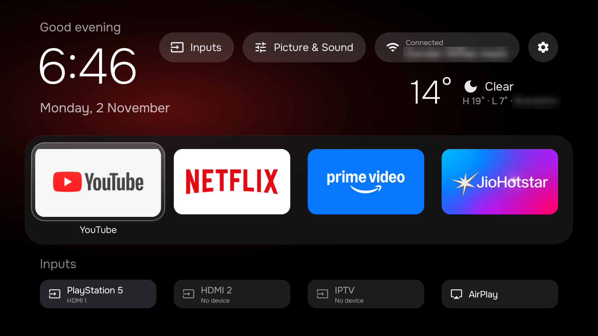

# Google TV Clean Up

Ad-free home screen and debloat for Google TV / Android TV sets over ADB, no root. Built and tested on a TCL G10 (Android TV 12) in November 2026.



*The home screen on the TCL. Wi-Fi name and city blurred.*

Based on [CleanTV](https://github.com/JohnWayneeee/cleantv) by JohnWayneeee (MIT, see `LICENSE` and `NOTICE`), with these additions:

- English labels
- Inputs row under the dock: HDMI ports named after the connected device (HDMI-CEC), plus AirPlay (Live TV stays in the Inputs pill menu)
- Hold OK on an app: Move, Add to dock, Remove from dock (saved on the TV)
- Dock and Inputs both on the first screen; Inputs as slim bars
- Wi-Fi pill shows "Connected" with the network name
- Picture & Sound pill: opens TCL's Picture or Sound panel
- Weather under the pills with a condition icon (sun/moon, cloud, fog, rain, snow, storm) (Open-Meteo, no account; refreshes every 30 min). Set `city`, `lat`, `lon`, `unit` in `launcher/weather.properties` (not in git; defaults to Toronto, °C). This is the launcher's only use of the internet.
- Colour glow behind the focused app, in the dock and in All apps; size is `glow_scale` in config.xml (120)
- Starts on the dock after power-on; Home while already home goes back to the dock
- `SettingsKeyService`: makes the remote's Settings button open Settings again after the Google TV home is disabled
- `KeyServiceGuard`: TCL's TV player switches accessibility off at every boot; the launcher turns the Settings-button service back on (only if you had it on). Needs the WRITE_SECURE_SETTINGS grant in step 8.

## Folders

| Path | What it is |
|---|---|
| `android-tv-setup/` | The original CleanTV scripts and notes (`references/*.md` explain each step) |
| `tvs/tcl-g10/launcher/` | The launcher source with all changes above. **Copy this for a new TV.** |
| `release/clean-tv-launcher.apk` | Ready-built launcher (weather defaults to Toronto), installable without build tools: `adb install release/clean-tv-launcher.apk` |
| `tvs/tcl-g10/clean-tv-launcher.apk` | Your own build with your `weather.properties` (not in git) |
| `tvs/tcl-g10/.tv` | The TV's address, e.g. `192.168.1.50:5555` (not in git; create it per step 3) |

## On the computer

```bash
brew install --cask android-platform-tools android-commandlinetools
brew install openjdk@17
export JAVA_HOME=$(brew --prefix openjdk@17)/libexec/openjdk.jdk/Contents/Home
export ANDROID_HOME=$HOME/Library/Android/sdk
sdkmanager --sdk_root=$ANDROID_HOME "platforms;android-35" "build-tools;35.0.0"
```

## Setting up another TV

1. On the TV: Settings → System → About → press OK on "Android TV OS build" 7 times. Then Developer options → turn on USB debugging (and Network debugging if listed).
2. Find it and connect (accept the "Allow USB debugging?" prompt on the TV):
   ```bash
   adb connect <tv-ip>:5555
   ```
3. Make a folder for it, copying this TV's launcher:
   ```bash
   mkdir -p tvs/<name> && cp -R tvs/tcl-g10/launcher tvs/<name>/ && echo "<tv-ip>:5555" > tvs/<name>/.tv
   rm -rf tvs/<name>/launcher/app/build tvs/<name>/launcher/.gradle
   ```
4. Edit `tvs/<name>/launcher/app/src/main/res/values/config.xml`:
   - `dock_apps`: the starting dock (you can rearrange later on the TV by holding OK)
   - `live_tv_package`: find it with
     `adb shell cmd package query-activities --brief -a android.intent.action.VIEW -t vnd.android.cursor.dir/channel`
     (TCL: `com.tcl.tv`)
   - `airplay_package` / `airplay_action`: TCL's AirPlay receiver; other brands differ or have none (the tile is then hidden)
   - `settings_scan_codes`: TCL remotes send 561. On another brand, find it with `adb shell getevent -l` while pressing the button.
5. Build and try it without taking over Home:
   ```bash
   cd tvs/<name> && bash ../../android-tv-setup/scripts/build-install.sh --no-home
   adb shell am start -n com.cleantv.launcher/.MainActivity
   ```
6. Take over Home (Google TV). **Check Wi-Fi first:**
   ```bash
   adb shell "dumpsys wifi | grep -o 'cname=[^ ]*' | sort -u"
   ```
   If it lists `setupwraith`, on the TV go to Settings → Network → your Wi-Fi → **Forget network**, then join it again. Then:
   ```bash
   adb shell pm disable-user --user 0 com.google.android.tungsten.setupwraith
   adb shell pm disable-user --user 0 com.google.android.apps.tv.launcherx
   bash ../../android-tv-setup/scripts/build-install.sh
   ```
7. Wi-Fi name on the pill:
   ```bash
   adb shell pm grant com.cleantv.launcher android.permission.ACCESS_FINE_LOCATION
   ```
8. Remote Settings button: on the TV, Settings → System → Accessibility → **Clean TV: remote Settings button** → On.
   Then let the launcher keep it on after reboots (TCL switches it off at every boot). This grants the launcher
   permission to change protected settings; it only uses it for this:
   ```bash
   adb shell pm grant com.cleantv.launcher android.permission.WRITE_SECURE_SETTINGS
   ```
   **Reinstalling the launcher wipes this grant on TCL**: run it again after every `build-install.sh`.
   Take it back with `pm revoke` instead of `pm grant`.

## Bloatware removed on the TCL

Removed with `adb shell pm uninstall --user 0 <package>`. Bring any back with `adb shell cmd package install-existing <package>`.

```
tv.samba.ssm.ui                 Samba TV (viewing tracker)
com.tcl.logkit                  TCL logging
com.tcl.messagebox              TCL promos
com.tcl.channelplus             TCL Channel
com.tcl.exhibit                 store demo mode
com.tcl.esticker                store stickers
com.tcl.hotelmenu               hotel menu
com.tcl.ocean.instructions      on-screen manual
com.tcl.repairguide             repair guide
com.tcl.usercenter              TCL account
com.tcl.smartalexa              Alexa
com.tcl.gamebar                 game bar
com.google.android.play.games   Play Games
com.google.android.feedback     Google feedback
com.android.printspooler        printing
com.tcl.dashboard               TCL Home
com.tcl.tv.plus                 TCL TV+
com.tcl.partnercustomizer       "TCL tv+" shortcut (remote's TCL key) and Google TV home tweaks
```

Also uninstalled completely (Play Store apps; reinstall from the Play Store): DAZN (`com.dazn`), Paramount+ (`com.cbs.ca`).

On another brand, the package names differ: list them with `adb shell pm list packages -s` and check each before removing.

## Undo everything

```bash
adb shell pm enable com.google.android.apps.tv.launcherx
adb shell pm enable com.google.android.tungsten.setupwraith
adb shell input keyevent KEYCODE_HOME
```
